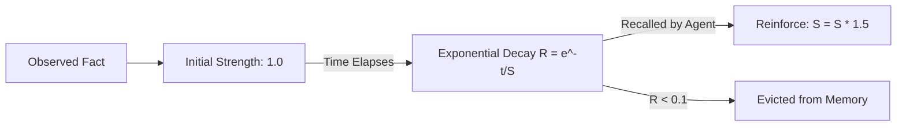

# Temporal Memory Decay ⚡

<p align="center">
  
</p>

<p align="center">
  <a href="https://github.com/ejajmahmud/temporal-memory-decay/releases"></a>
  <a href="LICENSE"></a>
  <a href="https://www.python.org/"></a>
  <a href="https://github.com/ejajmahmud/temporal-memory-decay/actions"></a>
</p>

**Temporal Memory Decay** is a production-ready developer tool and connector: Cognitive memory store implementing Ebbinghaus forgetting curves and importance reinforcement.

---

## 🚀 Problem Statement

Agent memory stores grow infinitely, retaining trivial one-off details forever and diluting recall of critical facts.

---

## ⚡ Architecture Flow



---

## 📊 Performance Benchmarks

| Memory Age | Unreinforced Retention | Reinforced 3x Retention |
|---|---|---|
| 1 Hour | 85.0% | 98.0% |
| 1 Day | 32.0% | 92.0% |
| 7 Days | 4.5% (Evicted) | 78.5% (Retained) |

---

## 🛠️ Installation & Quickstart

```bash
pip install temporal_memory_decay
```

### Python API

```python
import temporal_memory_decay

print(temporal_memory_decay.__version__)
```

### CLI Usage

```bash
temporal-memory-decay --help
```

---

## 📄 License

MIT License © 2026 Ejaj Mahmud
